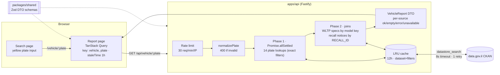

# Israeli License Plate Lookup

Enter an Israeli license plate (מספר רישוי) and get a full vehicle report: registration, tests, mileage, ownership history, open recalls, off-road status, disabled-parking permit, and technical/WLTP specs.

All data comes from the free public datasets on [data.gov.il](https://data.gov.il), the Israeli Government open-data portal (CKAN API, no key). **מקור: data.gov.il**

## Setup

Requirements: Node 20+ and pnpm 9 (`corepack enable` provides pnpm).

```bash
pnpm install
pnpm dev
```

- Web: http://localhost:5173 (Vite proxies `/api` to the API)
- API: http://127.0.0.1:3001

## Scripts

| Command                                            | What it does                                                           |
| -------------------------------------------------- | ---------------------------------------------------------------------- |
| `pnpm dev`                                         | Runs the API (`tsx watch`) and the web app (Vite) together             |
| `pnpm test`                                        | Runs every Vitest suite (shared, api, web)                             |
| `pnpm typecheck`                                   | Runs `tsc` on every package                                            |
| `pnpm lint`                                        | ESLint (flat config, typescript-eslint, `no-explicit-any` is an error) |
| `pnpm format` / `format:check`                     | Prettier                                                               |
| `pnpm build`                                       | Typechecks all packages and builds the web app to `apps/web/dist`      |
| `pnpm --filter @app/api start`                     | Runs the API without watch mode                                        |
| `pnpm --filter @app/api fixtures:record [plates…]` | Re-records real upstream responses into `apps/api/test/fixtures`       |

API environment variables: `PORT` (default `3001`), `HOST` (default `127.0.0.1`), and `LOG_LEVEL` (default `info`).
Web: `VITE_API_BASE_URL`. Leave it empty when the web app and API are served from the same origin. The API doesn't enable CORS.

## Repository layout

```
apps/
  api/            Fastify proxy/aggregator over data.gov.il
    src/config/datasets.ts   every resource ID and lookup field (nothing inlined)
    src/ckan/client.ts       fetch + 8s timeout + 1 retry with backoff + LRU cache (12h)
    src/mappers/*.ts         one Zod schema + mapper per dataset (Hebrew fields → English DTO)
    src/services/vehicleReport.ts  parallel lookups, fallbacks, joins → VehicleReport
    test/fixtures/*.json     real recorded responses for 3 plates
  web/            Vite + React 18 + TanStack Query + React Router + Tailwind
packages/
  shared/         DTO Zod schemas/types, plate normalize/format, alerts logic
docs/
  data-sources.md  dataset discovery notes, field maps, sample records
```

## Architecture



How a request works:

1. The API strips dashes and spaces, accepts 2–8 digits, and drops leading zeros.
2. It queries all plate-keyed datasets in parallel with exact `filters`.
3. It picks a base vehicle record by priority: registry → inactive → personal import → motorcycle → heavy → public → inactive without a model code.
4. It then runs the two joins: WLTP specs, using the model key from the base record, and recall notices, using the open recall IDs.
5. A failed dataset sets its section to `null` and its source status to `"error"`. The rest of the report is unaffected.

The web app validates the response with the same Zod schema.

### API

`GET /api/vehicle/:plate` returns `200` with a `VehicleReport` (see [`packages/shared/src/dto.ts`](packages/shared/src/dto.ts)):

```ts
{
  plate, found,
  summary,        // make/model/trim/year/color/fuel/origin (raw Hebrew kept for display)
  registry,       // test date, license expiry, on-road date, VIN, ownership type, tires…
  history,        // mileage at last test, first registration, structural change, LPG…
  ownership[],    // { since: 'YYYY-MM', type, typeRaw }, oldest first
  recalls[],      // open recalls enriched with fix method / importer contact
  flags: { stolen, offRoad, offRoadDate, disabledPermit, disabledPermitDate },
  specs,          // engine, power, transmission, safety equipment, pollution, WLTP CO₂
  sources[],      // { id, name, resourceId, status: 'ok'|'empty'|'error'|'unavailable' }
  fetchedAt
}
```

Error responses: `400 { error: 'invalid_plate' }` for a bad plate, `429 { error: 'rate_limited' }` when the rate limit is hit. `GET /api/health` returns `{ ok: true }`.

## Data sources

Full field maps and sample records are in [`docs/data-sources.md`](docs/data-sources.md).

| Dataset                             | Resource ID                            | Plate field                                             | Used for                                |
| ----------------------------------- | -------------------------------------- | ------------------------------------------------------- | --------------------------------------- |
| Private & commercial vehicles       | `053cea08-09bc-40ec-8f7a-156f0677aff3` | `mispar_rechev`                                         | Summary, registration & tests           |
| Vehicle history                     | `56063a99-8a3e-4ff4-912e-5966c0279bad` | `mispar_rechev`                                         | Mileage, origin, structural change, LPG |
| Ownership history                   | `bb2355dc-9ec7-4f06-9c3f-3344672171da` | `mispar_rechev`                                         | Ownership timeline                      |
| Unperformed recalls                 | `36bf1404-0be4-49d2-82dc-2f1ead4a8b93` | `MISPAR_RECHEV`                                         | Open recalls                            |
| Manufacturer recall notices         | `2c33523f-87aa-44ec-a736-edbb0a82975e` | join `RECALL_ID`                                        | Fix method, importer contact            |
| Removed from road (2010+)           | `851ecab1-0622-4dbe-a6c7-f950cf82abf9` | `mispar_rechev`                                         | Off-road flag                           |
| Removed from road 2010–2016         | `4e6b9724-4c1e-43f0-909a-154d4cc4e046` | `mispar_rechev` (8-char text)                           | Off-road flag                           |
| Removed from road 2000–2009         | `ec8cbc34-72e1-4b69-9c48-22821ba0bd6c` | `mispar_rechev` (8-char text)                           | Off-road flag                           |
| Disabled parking permits            | `c8b9f9c8-4612-4068-934f-d4acd2e3c06e` | `MISPAR RECHEV`                                         | Disabled-permit flag                    |
| Models & WLTP                       | `142afde2-6228-49f9-8a29-9b6c3a0cbe40` | join `tozeret_cd`+`degem_cd`+`shnat_yitzur`+`sug_degem` | Technical specs                         |
| Inactive vehicles (with model code) | `f6efe89a-fb3d-43a4-bb61-9bf12a9b9099` | `mispar_rechev`                                         | Fallback registry                       |
| Personal imports                    | `03adc637-b6fe-402b-9937-7c3d3afc9140` | `mispar_rechev`                                         | Fallback registry                       |
| Two-wheelers                        | `bf9df4e2-d90d-4c0a-a400-19e15af8e95f` | `mispar_rechev`                                         | Fallback registry                       |
| Over 3.5 t / no model code          | `cd3acc5c-03c3-4c89-9c54-d40f93c0d790` | `mispar_rechev`                                         | Fallback registry                       |
| Active public vehicles              | `cf29862d-ca25-4691-84f6-1be60dcb4a1e` | `mispar_rechev`                                         | Fallback registry                       |
| Inactive vehicles (no model code)   | `6f6acd03-f351-4a8f-8ecf-df792f4f573a` | `mispar_rechev`                                         | Fallback registry                       |
| Stolen vehicles                     | —                                      | —                                                       | **Not published** (see limitations)     |

## Testing

- **shared:** plate normalization and formatting, and the alerts logic (including the ≥4 ownership-changes and expired-license boundaries).
- **api:** one test per dataset mapper, run against real fixture records plus edge cases (legacy text columns, blanks, invalid types). Also CKAN client tests for exact filters, cache keys, 5xx retry, 4xx no-retry, timeout, and bad envelopes.
- **api integration:** Fastify `inject` with MSW serving the recorded fixtures. It covers the full report, the fallback registry, the recall join, off-road, not-found, a failing dataset staying isolated, invalid records, 400s, and the rate limit.
- **web:** report page tests with a fixture DTO. They cover skeletons, every section, the alerts banner, license overdue, the ownership timeline, per-section error and empty states, the sources footer and attribution, not-found, retry, the invalid URL plate, and the English/LTR toggle. Search page tests cover auto-formatting, the accessible error, and navigation.

Fixtures are real responses, recorded on 2026-11-05 for `36181801`, `1000822`, and `8959871`. The datasets publish no owner identities, so the fixtures contain none.

## Known limitations

- **Ownership and mileage history mostly covers passenger cars from 2017 onward.** The history datasets include only active private vehicles, starting in 2017. Older cars, commercial vehicles, motorcycles, and trucks usually have none. Ownership dates have month precision only.
- **Stolen status isn't available.** data.gov.il publishes no plate-level stolen-vehicle dataset, and the inactive-vehicle datasets explicitly exclude stolen vehicles. `flags.stolen` is always `null`, and the UI says so.
- **Open recalls only list recalls left unperformed for more than 6 months** after the importer's notice. A recall that was just announced won't appear yet.
- **Technical specs need a model code.** The WLTP catalogue covers private models from 1996 and commercial models from 1998. Motorcycles, heavy vehicles, personal imports, and public vehicles get no specs.
- **Data freshness:** the datasets refresh daily, and the API caches each lookup for 12 hours, so a report can be up to about 36 hours behind the ministry's records.
- **Free-text values stay in Hebrew** (color, trim, recall descriptions), including in the English UI. Enumerated values (ownership type, fuel) are translated.
- **The disabled-permit type code (`SUG TAV`) is undocumented**, so the app only shows whether a permit exists and when it was issued.
- **The cache and rate limit are in-memory and per process.** Use a shared store such as Redis if you run more than one instance.
- **Upstream latency is 1–4 s** for an uncached report (14–16 CKAN calls, run in parallel).
